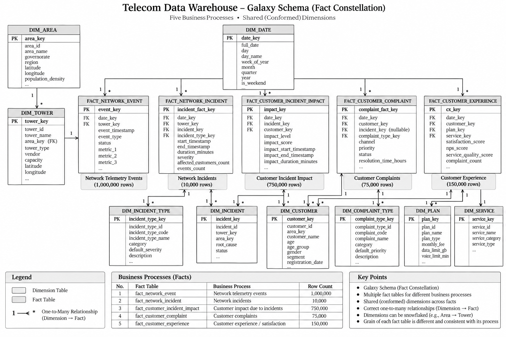

# Telecom Network Incident & Customer Impact Pipeline
# Signal360

### 360° View of Network & Customer Experience

Signal360 is an end-to-end **telecom data engineering platform** that combines network performance data with customer experience data to provide a unified view of service reliability and its impact on customers.

The project covers **batch and streaming ingestion, distributed processing, data storage, orchestration, data warehousing, transformation, and business intelligence**.

---

## Business Problem

Telecom operators generate large volumes of data from network infrastructure, customers, incidents, complaints, and service interactions.

When these datasets are analyzed separately, it becomes difficult to understand how network problems affect customers.

Signal360 connects these domains to answer questions such as:

- Which customers and areas are most affected by network incidents?
- Which towers generate the most network events?
- What is the average incident duration?
- Do network incidents lead to more customer complaints?
- How does network reliability affect customer experience?

---

## Architecture

The platform integrates batch and streaming data into a unified pipeline, using Spark for processing, Azure Data Lake and SeaweedFS for storage, Snowflake for analytical warehousing, dbt for transformation, and Power BI for reporting.

<p align="center">
  
</p>

Both **Azure Data Lake** and **SeaweedFS** can provide processed datasets to **Snowflake**, where the analytical transformation and modeling layer begins.

**Apache Airflow** orchestrates the pipeline, while **Docker Compose** provides the distributed local environment.

---

## Technology Stack

| Layer | Technology |
|---|---|
| Programming | Python |
| Streaming | Apache Kafka |
| Processing | Apache Spark / PySpark |
| Storage | Azure Data Lake, SeaweedFS |
| Orchestration | Apache Airflow |
| Data Warehouse | Snowflake |
| Transformation | dbt |
| Analytics | Power BI |
| Infrastructure | Docker / Docker Compose |
| Version Control | Git / GitHub |

---

## Data Pipeline

**Ingestion** — Batch datasets are ingested from CSV files, while network events are handled through Kafka.

**Processing** — PySpark performs data cleaning, validation, duplicate handling, datatype normalization, and transformations.

**Storage** — Processed datasets are stored in **Parquet format** across Azure Data Lake and SeaweedFS.

**Warehouse** — Processed datasets from the storage layer are loaded into **Snowflake** for analytical workloads.

**Transformation** — dbt builds analytical dimensions and facts and applies data quality tests.

**Analytics** — Power BI consumes the final analytical models for network reliability and customer experience reporting.

---

## Data Model

Signal360 uses a dimensional model designed to connect network activity with its impact on customers.

<p align="center">
  
</p>

The model includes dimensions for areas, towers, customers, plans, services, incidents, and complaint classifications, connected to facts covering network events, network incidents, customer impact, complaints, and customer experience.

---

## Running Locally

### Clone the repository

```bash
git clone https://github.com/ahmadmbadreldin/telecom-data-pipeline.git
cd telecom-data-pipeline
```

### Configure the environment

```bash
cp .env.example .env
```

Update the environment variables with the required Azure, Snowflake, and local service configuration.

### Start the infrastructure

```bash
docker compose up -d
```

Verify the running services:

```bash
docker compose ps
```

Airflow is available locally at `http://localhost:8080`.

---

## Key Analytics

The platform supports analysis of:

- Impacted customers by area
- Incidents by status and location
- Average incident duration
- Network events by tower
- Complaint trends and distribution
- Customer experience distribution
- Relationship between network incidents and customer complaints

---

## Project Goal

Signal360 transforms disconnected telecom datasets into a unified analytical platform that connects **network performance with customer experience**.

The platform helps the business move beyond identifying network failures to understanding their actual impact on customers.
